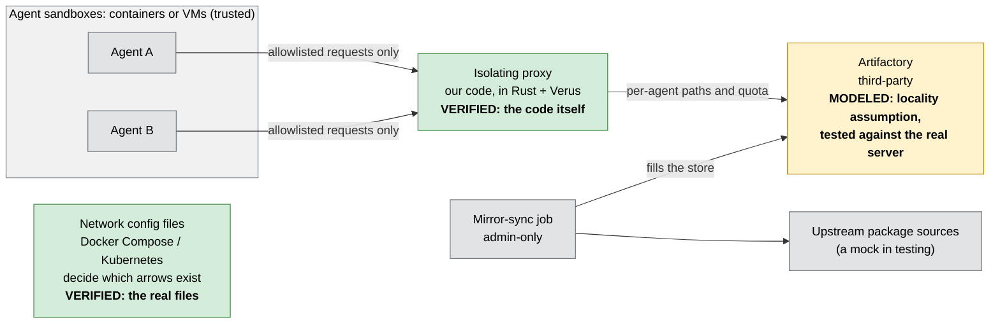
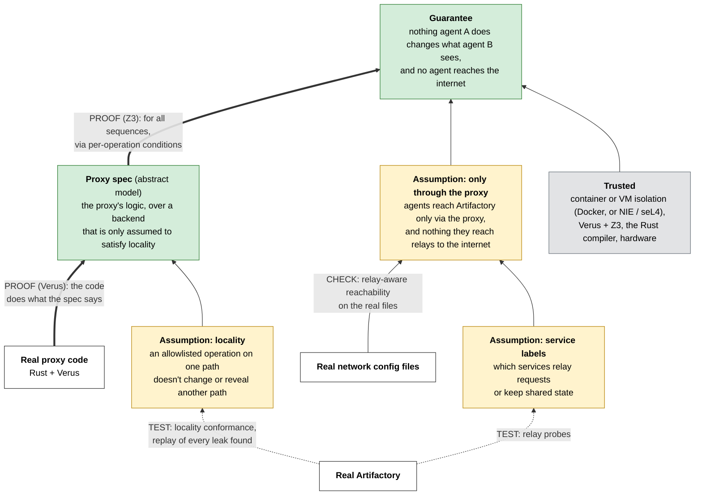

# Roadmap

The goal: two AI agents that share a package store (Artifactory) cannot
communicate through it, and cannot use it to reach the internet. This is the
isolation that failed in the OpenAI / Hugging Face incident.

No proof can cover the whole system. Artifactory is a large third-party Java
application, and nobody will verify it. So the system is split three ways:

- **Verified directly:** artifacts we control, checked as they actually run.
  These are the proxy's code and the real network config files.
- **Modeled, and the model tested against the real system:** components we
  can't verify. For these we state the one narrow assumption the proof needs,
  and test that assumption against the real thing.
- **Trusted:** the foundation everything sits on (container isolation, the
  verification tools, the compiler, the hardware).

## 1. The system, by how each part is assured

Green is verified directly, yellow is modeled and tested, gray is trusted.
Agents have no route to the upstream sources: the store's remote repositories
are off, and only the admin sync job can reach the upstream.

## 2. How the pieces add up to the guarantee

Each arrow says how one piece supports the one above it. **Thick arrows are
proofs**, solid arrows are exhaustive checks of real files, and **dotted
arrows are tests**, which build confidence but don't prove anything.

### How the model is related to the real system

| Link | Kind | What it establishes | If it fails |
|---|---|---|---|
| Proxy code → proxy spec | **Proof** (Verus) | The running proxy does exactly what the abstract proxy does, on every input | The code doesn't verify, so the bug is found before deployment |
| Proxy spec → guarantee | **Proof** (Z3) | No sequence of any length lets A affect B, given locality | Z3 returns a concrete leaking sequence |
| Real config files → "only through the proxy" | **Check**, exhaustive over the real files | No path from an agent to the store bypasses the proxy, and no path reaches the internet | It prints the path, e.g. `agent-a -> artifactory (relay) -> internet` |
| Artifactory → locality | **Test** (conformance) | On allowlisted operations, the real server behaves as the proof assumes | A mismatch is a candidate channel; confirm it by replay |
| Artifactory → service labels | **Test** (relay probes) | A service marked "not a relay" really doesn't fetch for its callers | Fix the label; the reachability check then fails |
| Leaks found in the model → real system | **Test** (replay) | Each leak the model reports is real | The model is wrong; fix it |

The proof's weakest points are the two tested assumptions. Keeping each one
narrow is deliberate. The proof needs only locality from Artifactory, not a
full model of it. And the proxy forwards only allowlisted operations, so
endpoints that cut across paths by design (search, "recently modified",
storage statistics) can't reach the backend at all.

## 3. Phases

| Phase | Work | Builds link | Status |
|---|---|---|---|
| 0 | Prototype: bounded search on a detailed model of the store; relay-aware reachability on hand-written configs; replay and conformance against a generic WebDAV server (wsgidav) | early versions of all links | **done** |
| 1 | Run Artifactory OSS in Docker with a mock upstream. Write the locality conformance test: for each allowlisted operation, run B's operations with and without A's operations on other paths, and compare | Artifactory → locality | next |
| 2 | Restructure the model into a proxy spec over a locality-only backend. Prove it with Z3 for sequences of any length, using per-operation conditions (the Nickel approach) | proxy spec → guarantee | |
| 3 | Build the real proxy in Rust with an allowlist. Prove in Verus that it implements the spec. Replay every earlier leak through it: all should fail | proxy code → proxy spec | |
| 4 | Have the reachability check read real Docker Compose / Kubernetes files. Add relay probes that test the service labels | real configs → only through the proxy | |
| 5 | Put two LLM agents in the sandboxes and tell them to find a way to communicate. Measure success with and without the proxy | evidence that the checked channels are the ones agents find | |

### What exists today versus the target

| Piece | Today | Target |
|---|---|---|
| Model | A detailed model of the store (`checker/model.py`); conformance found it wrong about folder GETs (403, not 404) | A proxy spec over a backend that satisfies only locality |
| Proof | Bounded search: two agents, two names, up to 4 steps | Z3 proof for all sequences, plus a Verus proof of the code |
| Proxy | Exists only in the model | Real Rust code with an allowlist |
| Real server | wsgidav, a generic WebDAV server | Artifactory OSS |
| Network config | JSON written by hand | Parsed from the real deployment files |

## Out of scope

- **Timing channels**, e.g. a cache hit being faster than a miss.
- **Escape from the container or VM.** Docker is trusted, or verified
  isolation (NIE, seL4) can be cited.
- **Channels outside the store**, such as other shared services. Each needs
  its own spec, or has to be shown unreachable by the network check.
- **Bugs in the trusted base:** Verus, Z3, the compiler, the hardware.
